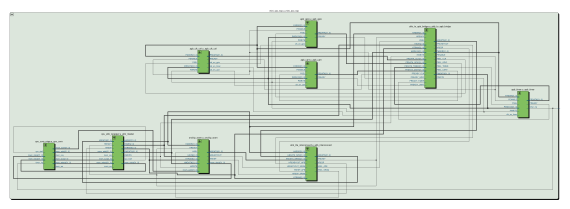
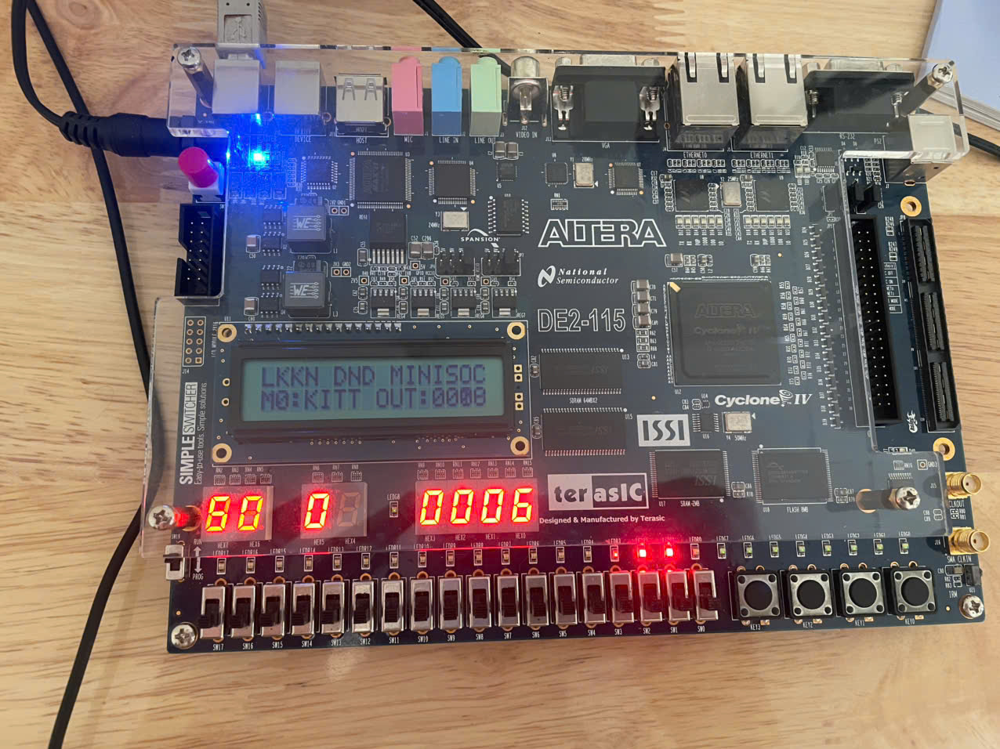
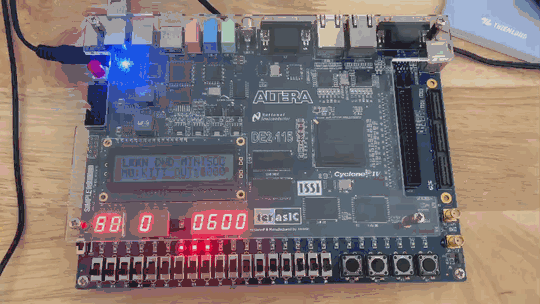
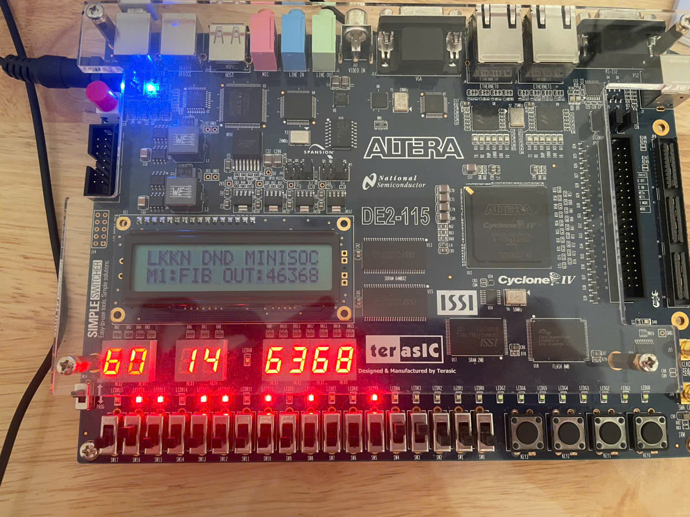
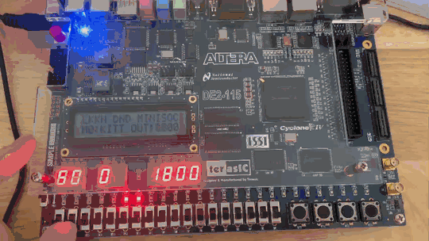
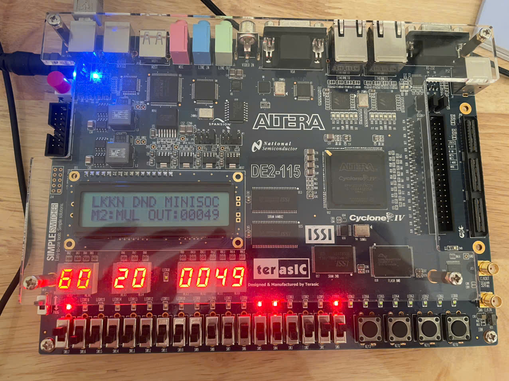
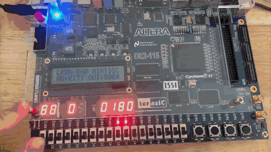
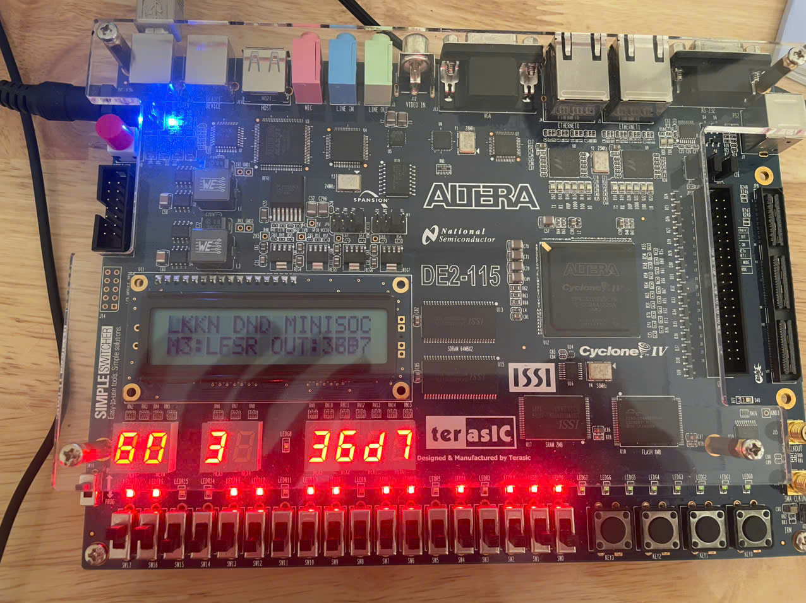
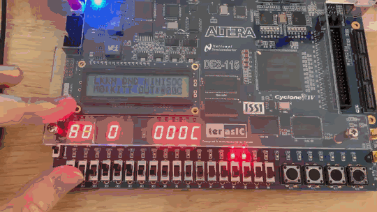

# LKKN-DND Mini-SoC: 32-Bit MIPS32 & AMBA 3 AHB-Lite / APB3 System-on-Chip

[-2ea44f?style=for-the-badge)](README.md)
[-d73a49?style=for-the-badge)](README.vi.md)

[-red.svg)](#)

*A complete 32-bit MIPS32 System-on-Chip designed in Verilog HDL with AMBA AHB-Lite interconnect, AHB-to-APB3 bridge, hardware timer interrupts, per-peripheral clock gating, and a 4-mode interactive firmware running on the Terasic DE2-115 FPGA.*

  
   
  <b>Figure 1:</b> Inside <code>mini_soc_top</code> — 9-Module RTL Netlist synthesized in Intel Quartus Prime (Click image to zoom in full Vector SVG resolution)

  
   
  <b>Figure 2:</b> Complete Top-Level Chip (<code>de2_115_wrapper</code>) integrating the Mini-SoC Core, 16-Stage Double-Dabble Binary-to-BCD Engine, 8× 7-Segment Drivers (<code>HEX7..HEX0</code>), and HD44780 16×2 LCD Controller (Click image to zoom)

---

## 1. Chip Overview & Key Specifications

**LKKN-DND Mini-SoC** is a custom 32-bit RISC System-on-Chip designed in Verilog HDL and deployed on the **Terasic DE2-115 FPGA board (`Intel Cyclone IV E EP4CE115F29C7` @ 50 MHz)**. It pairs a single-cycle MIPS32 processor core (with hardware interrupt support) with an industry-standard two-tier **ARM AMBA 3 AHB-Lite & APB3** interconnect fabric.

| Feature | Specification |
| :--- | :--- |
| **Chip Brand / ID** | `LKKN DND MINISOC` (Displayed live on onboard 16×2 Character LCD) |
| **Target FPGA** | Intel Cyclone IV E `EP4CE115F29C7` (Terasic DE2-115) @ `50.000 MHz` (`PIN_Y2`) |
| **CPU Core (`cpu_core_mips.v`)** | 32-Bit Single-Cycle MIPS32, 32 GPRs, Hardware IRQ Vector (`0x0000_0010`), `EPC` & `ERET` |
| **High-Speed Bus (`ahb_lite_interconnect.v`)** | AMBA 3 AHB-Lite (Pipelined Address/Data phases, Central Decoder, 2-Cycle `ERROR` Default Slave) |
| **On-Chip Memory (`onchip_sram.v`)** | Dual-Port SRAM (Port A: 0-Wait Instruction Fetch, Port B: Byte/Halfword/Word AHB Data Slave) |
| **Peripheral Bridge (`ahb_to_apb_bridge.v`)** | Synchronous AHB-to-APB3 FSM (`ST_IDLE -> ST_SETUP -> ST_ACCESS`) with automatic CPU wait-states |
| **APB Peripherals (`0x4000_0000`–`3FFF`)** | • **Slave 0 (`apb_gpio`):** 2-FF synchronized `SW[17:0]` inputs & masked `LEDR[17:0]` outputs • **Slave 1 (`apb_timer`):** 32-bit down-counter, auto-reload, W1C status & `timer_irq` generation • **Slave 2 (`apb_uart`):** `115200 8N1` UART Transmitter & 16× oversampled Receiver • **Slave 3 (`apb_clk_ctrl`):** Fine-grained synchronous peripheral clock gating (`clk_en_*`) |
| **Hardware Display Engine** | • **16-Bit Double-Dabble BCD Hardware Engine** driving 5-digit decimal output on `HEX4..HEX0` • **Live Program Counter Monitor** on `HEX7..HEX6` & Mode Indicator on `HEX5` • **HD44780 16×2 LCD Controller** showing `LKKN DND MINISOC` + live mode & decimal/hex output |
| **Silicon Utilization** | **9,094 Logic Elements (7.9%)** / **3,497 Dedicated Registers** |

---

## 2. Live Hardware Benchmark Suite on Terasic DE2-115 (`sw/firmware.hex`)

Instead of simple switch-to-LED wiring, the chip executes a **64-instruction MIPS32 benchmark firmware** ([sw/firmware.asm](sw/firmware.asm)) that demonstrates real-time interrupt multitasking, dynamic programming, software arithmetic, and hardware clock gating across **4 interactive modes** selected by **`SW[17:16]`**:

### Global Hardware Controls (Active in All Modes)
* **`SW[17:16]` — Mode Selector (`00`, `01`, `10`, `11`):** Selects the active benchmark algorithm (shown on `LEDR[17:16]`, `HEX5`, and LCD Line 2).
* **`SW[15]` — Hardware Clock-Gating Freeze (`PAUSED!`):** When `SW[15] = 1`, the CPU writes `0x5` to `apb_clk_ctrl` (`0x4000_3000`), gating off `clk_en_timer`. All timer-driven animations freeze instantly and the LCD displays **`PAUSED! OUT:xxxx`**.
* **`SW[14:12]` — Real-Time Timer Prescaler (`000`..`111`):** Dynamically updates `TIMER_RELOAD` (`0x4000_1008`) to scale the hardware interrupt frequency from **~12.5 Hz (fastest)** to **~1.5 Hz (slowest)**.
* **`KEY[0]` — Asynchronous Assert / Synchronous Deassert Reset:** Resets `PC` to `0x0000_0000`.

---

### 🔹 Mode `00` (`SW[17:16] = 00`): Interrupt-Driven KITT Scanner
* **How it works:** A 2-LED comet bar (`$s2`) bounces smoothly left and right across `LEDR[15:0]` inside the Timer Interrupt Service Routine (`0x0000_0010`), while the main loop overlays `SW[11:0]` via bitwise `XOR`.
* **Live LCD & 7-Segment Readout:** `LKKN DND MINISOC` / `M0:KITT OUT:0006` (`HEX7..6 = 80` PC, `HEX5 = 0`, `HEX3..0 = 0006`).

| 📸 Hardware Photo (`M0:KITT`) | 🎞️ Live Video / GIF Demo (Click GIF for `.mp4`) |
| :---: | :---: |
|  |  |

---

### 🔹 Mode `01` (`SW[17:16] = 01`): Dynamic Programming Fibonacci Engine ($F(N)$)
* **How it works:** Reads $N$ (`0..24`) from **`SW[4:0]`**, computes the $N$-th Fibonacci number iteratively ($F_n = F_{n-1} + F_{n-2}$) in CPU registers, and outputs the 16-bit binary result to `LEDR[15:0]` while the hardware Double-Dabble BCD engine displays the **exact 5-digit decimal value** on `HEX4..HEX0` and the LCD:
  * $N = 5$ (`SW[4:0] = 00101`) $\rightarrow$ **`00005`**
  * $N = 10$ (`SW[4:0] = 01010`) $\rightarrow$ **`00055`**
  * $N = 20$ (`SW[4:0] = 10100`) $\rightarrow$ **`06765`**
  * $N = 24$ (`SW[4:0] = 11000`) $\rightarrow$ **`46368`** (`1011_0101_0010_0000` on `LEDR[15:0]` — largest Fibonacci number fitting in 16-bit unsigned output $\le 65,535$)
* **Live LCD & 7-Segment Readout:** `LKKN DND MINISOC` / `M1:FIB OUT:46368` (`HEX4..0 = 46368`).

| 📸 Hardware Photo ($F(24) = 46,368$) | 🎞️ Live Video / GIF Demo (Click GIF for `.mp4`) |
| :---: | :---: |
|  |  |

---

### 🔹 Mode `10` (`SW[17:16] = 10`): Software Multiplication Engine ($A \times B$)
* **How it works:** Even though the single-cycle MIPS32 ALU has no hardware multiplier (`*`), the CPU multiplies a 6-bit operand **$A = \text{SW}[11:6]$ (`0..63`)** by a 6-bit operand **$B = \text{SW}[5:0]$ (`0..63`)** in software via an iterative accumulation loop and displays the **5-digit decimal product** on `HEX4..HEX0` and the LCD (`7 × 3 = 00021`, `7 × 7 = 00049`, up to `63 × 63 = 03969`)!
* **Live LCD & 7-Segment Readout:** `LKKN DND MINISOC` / `M2:MUL OUT:00049` (`HEX4..0 = 00049`).

| 📸 Hardware Photo ($7 \times 7 = 49$) | 🎞️ Live Video / GIF Demo (Click GIF for `.mp4`) |
| :---: | :---: |
|  |  |

---

### 🔹 Mode `11` (`SW[17:16] = 11`): 32-Bit LFSR Pseudo-Random Matrix & Clock-Gating Freezer (`PAUSED!`)
* **How it works:** On every Timer IRQ tick, the CPU advances a 32-bit Linear Feedback Shift Register (`$s4 = ($s4 << 1) ^ 0x5A39`) combined with the KITT wave to generate a pseudo-random 16-bit matrix pattern on `LEDR[15:0]`. Flipping **`SW[15] = 1`** writes to `apb_clk_ctrl` (`0x4000_3000`) to gate off `clk_en_timer`, freezing a random 16-bit number on screen and switching the LCD to **`PAUSED! OUT:xxxx`**!
* **Live LCD & 7-Segment Readout:** `LKKN DND MINISOC` / `M3:LFSR OUT:36D7` $\leftrightarrow$ `PAUSED! OUT:36D7`.

| 📸 Hardware Photo (`M3:LFSR OUT:36D7`) | 🎞️ Live Video / GIF Demo (`M3:LFSR` $\leftrightarrow$ `PAUSED!`) |
| :---: | :---: |
|  |  |

---

## 3. Repository Structure & Documentation

* **[docs/01_SRS_and_Architecture.md](docs/01_SRS_and_Architecture.md):** System Requirements Specification, Bus Timing & Block Diagrams.
* **[docs/02_Chip_Reference_Manual.md](docs/02_Chip_Reference_Manual.md):** Complete Memory Map & Bit-Level Register Programmer's Guide.
* **[docs/03_Step_By_Step_Learning_Guide.md](docs/03_Step_By_Step_Learning_Guide.md):** Step-by-Step Design Workflow, Theory, Algorithms & 3-Week Timeline.
* **`rtl/`:** Complete synthesizable Verilog HDL source code (11 modules).
* **`sw/`:** Annotated 4-Mode MIPS32 Firmware ([firmware.asm](sw/firmware.asm), [firmware.hex](sw/firmware.hex), [firmware.mif](sw/firmware.mif)).
* **`fpga/`:** Intel Quartus Prime project ([my_soc.qpf](fpga/my_soc.qpf)), DE2-115 pin assignments ([de2_115_wrapper.qsf](fpga/de2_115_wrapper.qsf)), 50 MHz timing constraints ([de2_115_wrapper.sdc](fpga/de2_115_wrapper.sdc)), and ready-to-program bitstream ([output_files/de2_115_wrapper.sof](fpga/output_files/de2_115_wrapper.sof)).
