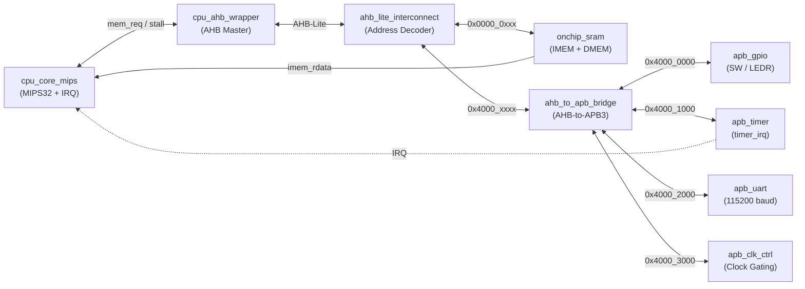

<div align="center">

# Mini-SoC: MIPS32 CPU, AMBA AHB/APB Bus & Peripherals

[](#)
[](#)
[](#)
[-red.svg)](#)
[](#)

*A complete 32-bit MIPS32 System-on-Chip designed in Verilog HDL with AMBA AHB-Lite interconnect, AHB-to-APB3 bridge, hardware timer interrupts, per-peripheral clock gating, and a 4-mode interactive firmware running on the Terasic DE2-115 FPGA.*

</div>

---

## Hardware Demo

[add video and discription]

## Key Highlights

- **Custom MIPS32 CPU (`cpu_core_mips`)**: Single-cycle execution with AHB bus-stall support (`cpu_stall`) and hardware interrupt handling (`timer_irq`, `epc`, `eret`).
- **Two-Tier AMBA Bus Architecture**:
  - **AHB-Lite** high-speed system bus connecting the CPU wrapper to On-Chip SRAM and the APB bridge.
  - **APB3** low-power peripheral bus (`ST_IDLE` → `ST_SETUP` → `ST_ACCESS`).
- **4 Memory-Mapped Peripherals**: GPIO (`SW`/`LEDR`), Programmable Timer (with IRQ), UART (115200 baud), and Clock Gating Controller.
- **DE2-115 Board Integration (`de2_115_wrapper`)**: Reset synchronizer (`KEY[0]`), Double-Dabble Binary-to-BCD converter, 8-digit 7-segment display (`HEX0`–`HEX7`), and 16×2 LCD controller.

---

## System Architecture



---

## Memory Map

| Region | Base Address | Bus | Module | Description |
| :--- | :--- | :--- | :--- | :--- |
| **On-Chip SRAM** | `0x0000_0000` | AHB-Lite | `onchip_sram` | Instruction & Data memory (`firmware.hex` / `.mif`) |
| **GPIO** | `0x4000_0000` | APB3 | `apb_gpio` | `SW[17:0]` input & `LEDR[17:0]` output |
| **Timer** | `0x4000_1000` | APB3 | `apb_timer` | Control, interrupt status (W1C), & reload value |
| **UART** | `0x4000_2000` | APB3 | `apb_uart` | Serial TX/RX (115200 baud @ 50 MHz) |
| **Clock Control** | `0x4000_3000` | APB3 | `apb_clk_ctrl` | Dynamic clock-gating enable bits for APB slaves |

---

## Repository Structure

```text
├── docs/       # SRS, Architecture specs, Chip Reference Manual & Learning Guide
├── fpga/       # Intel Quartus Prime 20.1.1 project (.qpf, .qsf, .sdc, output_files/)
├── rtl/        # Verilog HDL source files (CPU, AHB/APB buses, peripherals, DE2-115 wrapper)
└── sw/         # MIPS32 assembly firmware (firmware.asm, firmware.hex, firmware.mif)
```

<details>
<summary><b>Click to expand: RTL Module Breakdown (11 files)</b></summary>

| File | Role |
| :--- | :--- |
| `rtl/cpu_core_mips.v` | MIPS32 CPU core (decode, regfile, ALU, branch/jump, IRQ & `eret`) |
| `rtl/cpu_ahb_wrapper.v` | Converts CPU memory interface to AHB-Lite (`ST_ADDR_PHASE` / `ST_DATA_PHASE`) |
| `rtl/ahb_lite_interconnect.v` | AHB address decoder (`HSEL_SRAM`, `HSEL_APB`, `HSEL_DEF`) & response mux |
| `rtl/onchip_sram.v` | Dual-port-like instruction & data SRAM preloaded with firmware |
| `rtl/ahb_to_apb_bridge.v` | AHB-Lite to APB3 protocol bridge & secondary APB slave decoder |
| `rtl/apb_gpio.v` | APB GPIO controller for switches and red LEDs |
| `rtl/apb_timer.v` | APB hardware timer generating `timer_irq` |
| `rtl/apb_uart.v` | APB UART transceiver |
| `rtl/apb_clk_ctrl.v` | APB clock-gating controller (`clk_en_gpio`, `clk_en_timer`, `clk_en_uart`) |
| `rtl/mini_soc_top.v` | Top-level SoC integrating CPU, buses, SRAM, and peripherals |
| `rtl/de2_115_wrapper.v` | Terasic DE2-115 board wrapper (reset sync, BCD, 7-seg `HEX0`–`HEX7`, LCD) |

</details>

---

## FPGA Implementation Results

Synthesized and fitted on **Terasic DE2-115** (`EP4CE115F29C7`) using **Quartus Prime 20.1.1 Lite Edition**:

| Resource | Usage | Available | Utilization |
| :--- | :---: | :---: | :---: |
| **Total Logic Elements** | 7,625 | 114,480 | 7% |
| **Combinational Functions** | 6,824 | 114,480 | 6% |
| **Dedicated Logic Registers** | 3,519 | 114,480 | 3% |
| **I/O Pins** | 109 | 529 | 21% |

---

## Getting Started (Terasic DE2-115)

1. Open `fpga/my_soc.qpf` in **Intel Quartus Prime (20.1.1+)**.
2. Verify `de2_115_wrapper` is set as the Top-Level Entity.
3. Run **Compile Design** (or use the pre-built `fpga/output_files/de2_115_wrapper.sof`).
4. Open **Programmer** and flash `.sof` to the DE2-115 board via **USB-Blaster**.

### Interactive Firmware Controls (`sw/firmware.asm`)

| Control | Function |
| :--- | :--- |
| **`KEY[0]`** | Active-low system reset |
| **`SW[17:16]`** | **Mode Selector** (shown on `LEDR[17:16]`):<br>• `00`: Knight Rider (KITT) Scanner XOR `SW[11:0]`<br>• `01`: Fibonacci Calculator `Fib(SW[4:0])` (Decimal on `HEX`)<br>• `10`: Software Multiplier `SW[11:6] × SW[5:0]` (Decimal on `HEX`)<br>• `11`: 32-bit LFSR Matrix + KITT Wave |
| **`SW[15]`** | **Hardware Clock-Gating Freeze** (`1` = Gate Timer clock, `0` = Run) |
| **`SW[14:12]`** | **Timer Speed** (`000` = Fastest ~0.08s, `111` = Slowest ~0.67s) |
