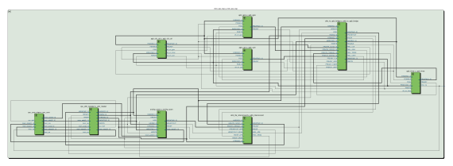
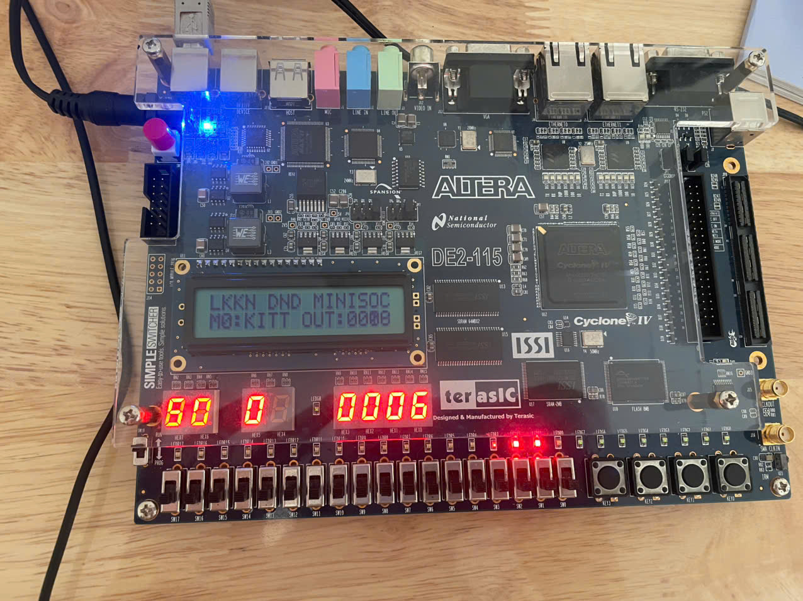
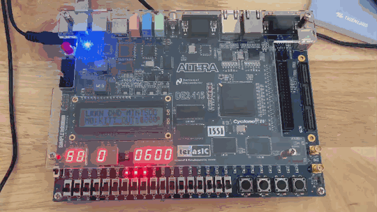
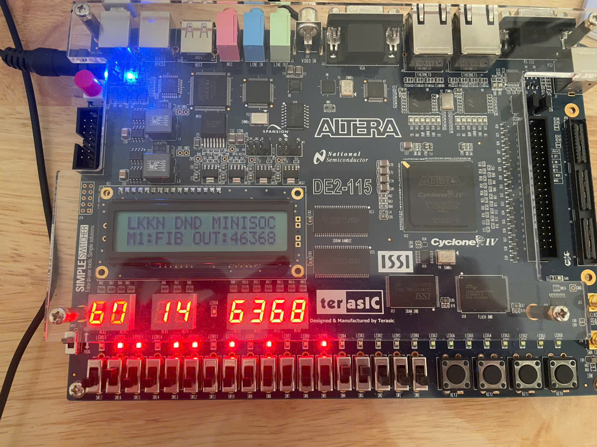
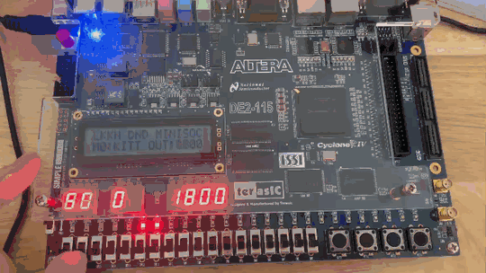
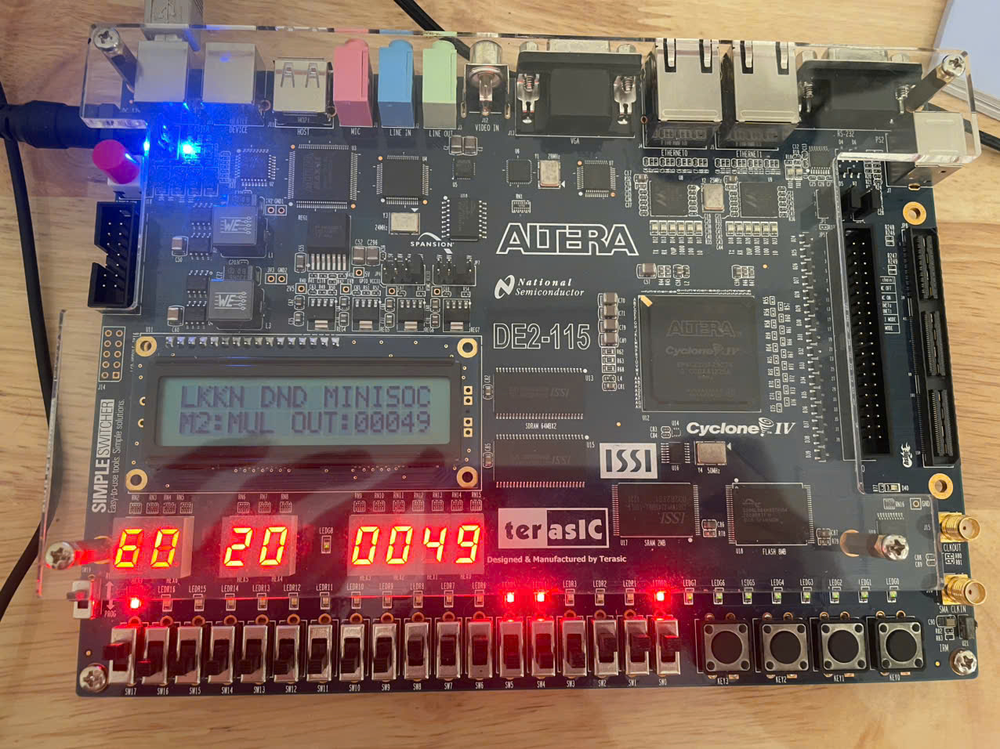
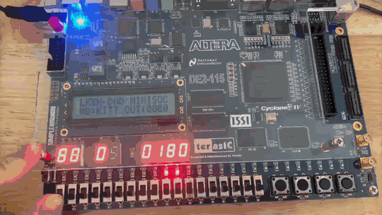
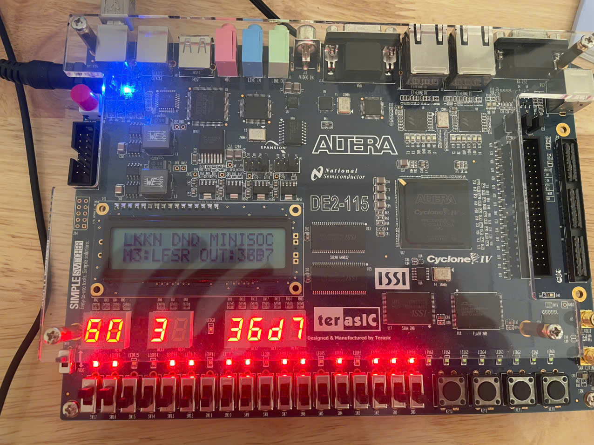
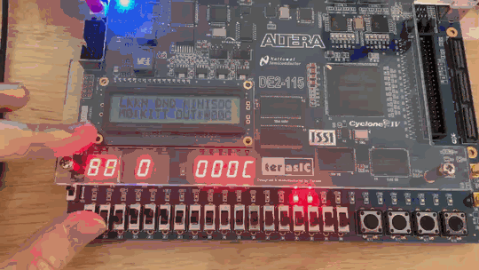

<div align="center">

# LKKN-DND Mini-SoC: Tự Thiết Kế Chip Vi Xử Lý 32-Bit & Hệ Thống Máy Tính Thu Nhỏ Trên FPGA

[-0366d6?style=for-the-badge)](README.md)
[-2ea44f?style=for-the-badge)](README.vi.md)

[](#)
[](#)
[](#)
[-red.svg)](#)
[](#)

*Dự án tự thiết kế từ con số 0 một "con chip máy tính thu nhỏ" (System-on-Chip) hoàn chỉnh bằng ngôn ngữ phần cứng Verilog, nạp xuống bảng mạch điện tử FPGA Terasic DE2-115 để chạy các thuật toán tính toán và điều khiển màn hình theo thời gian thực.*

</div>

<p align="center">
  <a href="docs/images/mini_soc_top.svg">
    
  </a>
  <br/>
  <sub><b>Hình 1:</b> Bản vẽ "giải phẫu" 9 bộ phận bên trong lõi chip <code>mini_soc_top</code> do nhóm tự thiết kế (Bấm vào ảnh để phóng to xem từng sợi dây nối)</sub>
</p>

<p align="center">
  <a href="docs/images/full_chip.svg">
    
  </a>
  <br/>
  <sub><b>Hình 2:</b> Toàn cảnh con chip hoàn chỉnh (<code>de2_115_wrapper</code>) khi ghép thêm mạch đổi số thập phân bậc thang, bộ điều khiển 8 đèn số đỏ và màn hình chữ LCD (Bấm vào ảnh để phóng to)</sub>
</p>

---

## 1. Giới Thiệu Dễ Hiểu (Dành Cho Mọi Người & Gia Đình)

Bình thường khi sử dụng điện thoại hay máy tính, bên trong chúng đều có một **con chip vi xử lý (CPU)** làm nhiệm vụ suy nghĩ và tính toán. Trong đồ án này, thay vì mua một con chip làm sẵn, tụi con đã **tự tay viết từng dòng lệnh thiết kế mạch điện để chế tạo ra một con chip máy tính 32-bit của riêng mình** mang tên **`LKKN DND MINISOC`**:

1. **Bộ não trung tâm (`CPU MIPS32`):** Có khả năng đọc hiểu 64 câu lệnh chương trình, tự làm các phép tính cộng, trừ, nhân, so sánh và xử lý đa nhiệm.
2. **Hệ thống đường cao tốc truyền dữ liệu (`AMBA AHB-Lite & APB3`):** Giống như hệ thống giao thông trong thành phố, giúp bộ não CPU liên lạc siêu tốc với bộ nhớ RAM và các thiết bị bên ngoài mà không bị kẹt xe.
3. **4 Thiết bị ngoại vi tích hợp sẵn trong chip:**
   - **Bộ đọc công tắc & bật đèn (`GPIO`):** Đọc thao tác gạt 18 công tắc của người dùng và điều khiển 18 bóng đèn LED đỏ.
   - **Đồng hồ bấm giờ tự động (`Timer`):** Đếm chính xác từng phần triệu giây để nhắc CPU làm việc đúng giờ.
   - **Cổng giao tiếp máy tính (`UART`):** Truyền tin nhắn từ mạch lên máy tính.
   - **Công tắc tiết kiệm điện thông minh (`Clock Controller`):** Có thể ngắt xung nhịp của các bộ phận đang nghỉ để tiết kiệm năng lượng.
4. **Màn hình hiển thị trực quan:** Tự động đổi kết quả nhị phân của máy tính sang **con số thập phân bình thường** để hiện lên **8 đèn số màu đỏ (`HEX7..HEX0`)** và **màn hình chữ tinh thể lỏng LCD (`LKKN DND MINISOC`)**.

| Thông số của Chip | Chi tiết |
| :--- | :--- |
| **Tên hiển thị trên màn hình LCD** | `LKKN DND MINISOC` |
| **Bảng mạch thử nghiệm** | Terasic DE2-115 (`Intel Cyclone IV E EP4CE115F29C7`), tốc độ **50 triệu nhịp/giây (50 MHz)** |
| **Số lượng linh kiện logic sử dụng** | **9,094 khối Logic Elements** và **3,497 thanh ghi Flip-Flops** |

---

## 2. Xem Con Chip Hoạt Động Thực Tế Qua 4 Chế Độ

Để chứng minh con chip thực sự "biết suy nghĩ và tính toán" chứ không chỉ là mạch bật/tắt đèn thông thường, tụi con đã nạp vào bộ nhớ của chip một phần mềm gồm **4 chế độ thông minh** (chọn bằng 2 công tắc ngoài cùng bên trái **`SW17`** và **`SW16`**):

### 🔹 Chế độ `00` (`SW[17:16] = 00`): Hiệu ứng Sóng Ánh Sáng Chạy Qua Lại (`M0:KITT`)
* **Con chip làm gì?** Đồng hồ bên trong chip tự động đếm thời gian và báo cho bộ não CPU dịch chuyển 2 bóng đèn sáng lướt mượt mà từ phải sang trái, chạm mép trái lại tự động nảy ngược về bên phải. Người dùng có thể gạt công tắc `SW[14:12]` để tăng tốc hoặc giảm tốc độ chạy của đèn ngay lập tức!
* **Màn hình hiển thị:** Dòng trên hiện tên nhóm **`LKKN DND MINISOC`**, dòng dưới hiện **`M0:KITT OUT:0006`**.

| Ảnh chụp thực tế trên mạch (`M0:KITT`) | Video hoạt động thực tế (Bấm vào ảnh để mở `.mp4`) |
| :---: | :---: |
| <a href="docs/images/mode00_kitt.jpg"></a> | <a href="docs/images/mode00_kitt.mp4"></a> |

---

### 🔹 Chế độ `01` (`SW[17:16] = 01`): Giải Bài Toán Dãy Số Fibonacci ($F(N)$)
* **Con chip làm gì?** Dãy số Fibonacci là dãy số nổi tiếng trong toán học mà số sau bằng tổng 2 số liền trước ($0, 1, 1, 2, 3, 5, 8, 13, 21, 34, 55, \dots$). Khi gạt công tắc chọn số thứ tự $N$ (từ 0 đến 24), bộ não CPU tự chạy vòng lặp cộng dồn liên tiếp và hiện ngay đáp số lên màn hình:
  * Chọn $N = 10$ $\rightarrow$ Màn hình hiện **`00055`**
  * Chọn $N = 20$ $\rightarrow$ Màn hình hiện **`06765`**
  * Chọn $N = 24$ $\rightarrow$ Màn hình hiện **`46368`** (`M1:FIB OUT:46368`) chỉ trong chưa đầy một phần triệu giây!

| Ảnh chụp thực tế ($F(24) = 46,368$) | Video hoạt động thực tế (Bấm vào ảnh để mở `.mp4`) |
| :---: | :---: |
| <a href="docs/images/mode01_fib.jpg"></a> | <a href="docs/images/mode01_fib.mp4"></a> |

---

### 🔹 Chế độ `10` (`SW[17:16] = 10`): Máy Tính Nhân Hai Số Bằng Phần Mềm ($A \times B$)
* **Con chip làm gì?** Dù phần cứng cơ bản chỉ có mạch Cộng và Trừ, tụi con đã lập trình cho CPU tự thực hiện phép nhân hai số $A \times B$ bằng thuật toán cộng lặp. Khi gạt số thứ nhất ($A$) và số thứ hai ($B$) trên hàng công tắc, màn hình lập tức hiện tích số (ví dụ $7 \times 3 = 21$, $7 \times 7 = 49$):
* **Màn hình hiển thị:** **`M2:MUL OUT:00049`** và đèn số đỏ hiện **`00049`**.

| Ảnh chụp thực tế ($7 \times 7 = 49$) | Video hoạt động thực tế (Bấm vào ảnh để mở `.mp4`) |
| :---: | :---: |
| <a href="docs/images/mode10_mul.jpg"></a> | <a href="docs/images/mode10_mul.mp4"></a> |

---

### 🔹 Chế độ `11` (`SW[17:16] = 11`): Vòng Quay Số Ngẫu Nhiên & Công Tắc "Đóng Băng Thời Gian" (`PAUSED!`)
* **Con chip làm gì?**
  - Khi chạy bình thường, CPU liên tục trộn các con số để tạo ra hiệu ứng đèn nhảy ngẫu nhiên giống như ma trận máy tính (`M3:LFSR`).
  - **Điểm đặc biệt nhất:** Khi gạt công tắc **`SW15`**, CPU ra lệnh cắt xung nhịp của bộ đếm thời gian để tiết kiệm điện. Ngay lập tức, toàn bộ dàn đèn đang nhảy **đứng băng tại chỗ** và màn hình LCD báo chữ **`PAUSED!`** (Tạm dừng). Khi gạt `SW15` xuống, mọi thứ lại chạy tiếp!

| Ảnh chụp thực tế (`M3:LFSR OUT:36D7`) | Video thử tính năng Đóng băng `PAUSED!` (Bấm để mở `.mp4`) |
| :---: | :---: |
| <a href="docs/images/mode11_lfsr.jpg"></a> | <a href="docs/images/mode11_lfsr.mp4"></a> |

---

## 3. Cấu Trúc Thư Mục Dự Án

* **[README.md](README.md):** Bản giới thiệu tiếng Anh (Main English Documentation).
* **[docs/01_SRS_and_Architecture.md](docs/01_SRS_and_Architecture.md):** Tài liệu đặc tả kiến trúc hệ thống và sơ đồ khối.
* **[docs/02_Chip_Reference_Manual.md](docs/02_Chip_Reference_Manual.md):** Sổ tay tra cứu bản đồ bộ nhớ và thanh ghi của con chip.
* **[docs/03_Step_By_Step_Learning_Guide.md](docs/03_Step_By_Step_Learning_Guide.md):** Hướng dẫn từng bước thực hiện đồ án và lộ trình 3 tuần.
* **`rtl/`:** Toàn bộ 11 file mã nguồn phần cứng Verilog tạo nên con chip.
* **`sw/`:** Mã nguồn phần mềm 4 chế độ ([firmware.asm](sw/firmware.asm), [firmware.hex](sw/firmware.hex), [firmware.mif](sw/firmware.mif)).
* **`sim/`:** Bộ testbench tự kiểm tra, AHB Protocol Checker và script chạy mô phỏng ([run_sim.bat](sim/run_sim.bat), [Makefile](sim/Makefile)).
* **`fpga/`:** Project Quartus Prime và file nạp mạch ([output_files/de2_115_wrapper.sof](fpga/output_files/de2_115_wrapper.sof)).

---

## 4. Hướng Dẫn Mô Phỏng & Kiểm Tra (Simulation & Testbench)

Thư mục `sim/` chứa bộ testbench tự kiểm tra (self-checking) chuẩn SystemVerilog (`iverilog -g2012`) để xác minh hoạt động của CPU, bus AMBA AHB-Lite, cầu nối APB3 và các ngoại vi trước khi nạp xuống FPGA.

### 4.1. Thành phần trong `sim/`
* **[ahb_protocol_checker.sv](sim/ahb_protocol_checker.sv):** Bộ giám sát giao thức AMBA 3 AHB-Lite (kiểm tra X/Z, tính ổn định địa chỉ/điều khiển trong wait-state và phản hồi lỗi `HRESP` 2 chu kỳ).
* **[tb_unit_suite.sv](sim/tb_unit_suite.sv):** Unit test kiểm tra riêng lẻ SRAM (Word/Halfword/Byte), Default Slave `HRESP`, APB GPIO, APB Timer (IRQ & W1C), APB Clock Controller và APB UART (loopback).
* **[tb_mini_soc.sv](sim/tb_mini_soc.sv):** Testbench toàn hệ thống (`mini_soc_top`) chạy firmware thật `sw/firmware.hex` qua cả 4 chế độ (`00`, `01`, `10`, `11`), kèm bộ giải mã Serial UART 8N1 và AHB Protocol Checker.
* **[gtkwave_setup.gtkw](sim/gtkwave_setup.gtkw):** Cấu hình sẵn nhóm tín hiệu để mở xem dạng sóng nhanh trong GTKWave.
* **[run_sim.bat](sim/run_sim.bat)** / **[Makefile](sim/Makefile):** Script tự động biên dịch và chạy toàn bộ mô phỏng.

### 4.2. Yêu cầu cài đặt
* **Icarus Verilog** (`iverilog` & `vvp`, hỗ trợ `-g2012`) đã thêm vào `PATH`.
* *(Tùy chọn)* **GTKWave** để xem file sóng `.vcd`.

### 4.3. Cách chạy mô phỏng

**Trên Windows (CMD / PowerShell / bấm đúp):**
* Bấm đúp trực tiếp vào [sim/run_sim.bat](sim/run_sim.bat) trong File Explorer, hoặc chạy trong terminal:
```bat
sim\run_sim.bat
```

**Trên Linux / macOS / WSL:**
```bash
cd sim
make all     # Chạy cả tb_unit_suite và tb_mini_soc
make unit    # Chỉ chạy unit test
make soc     # Chỉ chạy full SoC testbench
make wave    # Mở waveform tb_mini_soc.vcd bằng GTKWave
make clean   # Xóa các file .vvp và .vcd tạm
```

### 4.4. Kết quả mong đợi
Khi chạy thành công, màn hình sẽ báo `ALL TESTS PASSED` / `0 FAILED` cho cả hai bài test:
* `tb_unit_suite`: **11 PASSED, 0 FAILED** (0 lỗi giao thức AHB).
* `tb_mini_soc`: **8 PASSED, 0 FAILED** (0 lỗi giao thức AHB).
