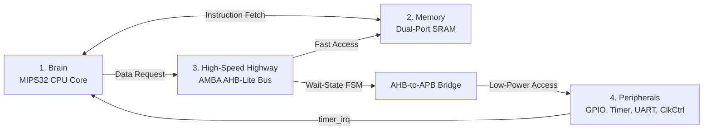

# Step-by-Step Learning & Implementation Guide
**Project:** Topic 19 — 32-Bit MIPS32 & AMBA 3 AHB-Lite / APB3 Mini-SoC  
**Target Platform:** Terasic DE2-115 (`EP4CE115F29C7` Cyclone IV E @ 50 MHz)
**Work by:** Luong Khuc Khoa Nguyen - ITITIU24039, Dau Ngoc Duc - ITITIU24007
---

## 1. Core Theory Made Simple

Think of this **Mini-SoC (System-on-Chip)** as a complete miniature computer built inside a single FPGA chip. It consists of four main parts working together:



### 1.1 The Brain: Single-Cycle MIPS32 CPU (`cpu_core_mips.v`)
* Executes one 32-bit instruction per clock cycle (unless stalled by a slow bus access).
* **Hardware Interrupts (`timer_irq`):** When the hardware timer reaches `0`, the CPU automatically saves the next Program Counter into `EPC`, disables nested interrupts, and jumps to the Interrupt Service Routine (ISR) at `0x0000_0010`. Executing `ERET` (`0x42000018`) returns the CPU to normal execution.

### 1.2 The Two-Tier Bus Hierarchy (AMBA 3 AHB-Lite & APB3)
Why use two buses instead of wiring everything directly to the CPU?
1. **AHB-Lite (High-Speed Highway):** Connects the CPU to fast On-Chip SRAM (`0x0000_0000`). Uses a **2-phase pipeline** (Address Phase in Cycle 1, Data Phase in Cycle 2) for maximum throughput. Unmapped addresses trigger the **Default Slave** (`HRESP = ERROR`).
2. **APB3 (Low-Power Peripheral Street):** Connects slower I/O blocks (`0x4000_0000` – `0x4000_3FFF`). The **AHB-to-APB Bridge** (`ahb_to_apb_bridge.v`) automatically stalls the CPU (`HREADY = 0`) for 2 cycles while converting an AHB transfer into an APB `SETUP -> ACCESS` sequence.

### 1.3 Low-Power Clock Gating (`apb_clk_ctrl.v`)
Instead of wasting power running all peripherals continuously, software can write to `CLK_EN_REG` (`0x4000_3000`) to disable the synchronous clock enable (`clk_en_timer`, `clk_en_uart`, `clk_en_gpio`) of any unused peripheral.

---

## 2. Step-by-Step Engineering Workflow

### Step 1: Designing the CPU & Bus Wrapper
We first built the MIPS32 datapath (`ALU`, `32x32 Register File`, `Control Unit`) and wrapped its memory port inside `cpu_ahb_wrapper.v`.
```verilog
// CPU stalls automatically during AHB Address Phase or when Slave is not ready
assign cpu_stall = (state == ST_ADDR_PHASE) ? mem_req : ~HREADY;
```

### Step 2: Building the Interconnect & Bridge FSM
Next, we decoded the 32-bit address space in `ahb_lite_interconnect.v` and implemented the 3-state AHB-to-APB Bridge (`ST_IDLE -> ST_SETUP -> ST_ACCESS`):
```verilog
// Central AHB Address Decoder
if (HADDR[31:12] == 20'h00000)      HSEL_SRAM = 1'b1; // 0x0000_0000 (SRAM)
else if (HADDR[31:14] == 18'h10000) HSEL_APB  = 1'b1; // 0x4000_0000 (APB Window)
else                                HSEL_DEF  = 1'b1; // Unmapped -> Error
```

### Step 3: Designing the 4 APB Peripherals
Each peripheral is mapped to a 4 KB slot behind the APB bridge:
* **GPIO (`0x4000_0000`):** 2-FF synchronizer for `SW[17:0]` inputs and masked output register for `LEDR[17:0]`.
* **Timer (`0x4000_1000`):** 32-bit down-counter with auto-reload and Write-1-to-Clear (`W1C`) interrupt status.
* **UART (`0x4000_2000`):** `115200 8N1` serial transmitter and oversampled receiver (`BAUD_DIV = 434` @ 50 MHz).
* **Clock Controller (`0x4000_3000`):** 3-bit register controlling `clk_en_gpio`, `clk_en_timer`, and `clk_en_uart`.

### Step 4: Writing the 4-Mode Firmware Algorithms (`sw/firmware.asm`)
Because hardware is only a shell without software, we wrote a 64-instruction MIPS32 benchmark firmware loaded into `onchip_sram.v`:

1. **Algorithm 1 — Interrupt-Driven KITT Scanner & LFSR (`_irq_vec`):**
   Every Timer IRQ updates a 32-bit Linear Feedback Shift Register (LFSR) for pseudo-random generation and shifts the 2-LED KITT bar left/right:
   ```mips
   _irq_vec:
       sw    $k0, 0x1004($s0)        # Clear Timer IRQ flag (W1C)
       sll   $k1, $s4, 1             # LFSR shift left
       xori  $s4, $k1, 0x5A39        # XOR feedback polynomial
       ...
       eret                          # Return from interrupt
   ```
2. **Algorithm 2 — Dynamic Programming Fibonacci (`Mode 01`):**
   Computes $F(N)$ iteratively in registers for $N = \text{SW}[4:0]$:
   ```mips
   _fib_loop:
       beq   $t1, $zero, _display    # Done when N == 0
       addu  $t3, $t4, $t2           # next = f0 + f1
       ori   $t4, $t2, 0x0000        # f0 = f1
       ori   $t2, $t3, 0x0000        # f1 = next
       addiu $t1, $t1, -1            # N--
       j     _fib_loop
   ```
3. **Algorithm 3 — Software Multiplication (`Mode 10`):**
   Since the single-cycle ALU has no hardware multiplier (`*`), the CPU multiplies $A \times B$ (`SW[11:6] * SW[5:0]`) via an iterative addition loop.

### Step 5: FPGA Synthesis & Board Deployment (Quartus Prime)
1. **Top-Level Integration (`de2_115_wrapper.v`):** Synchronizes active-low `KEY[0]` reset and maps `CLOCK_50`, `SW[17:0]`, `LEDR[17:0]`, and `UART_TXD/RXD` to Cyclone IV E pins (`de2_115_wrapper.qsf`).
2. **Timing Constraints (`de2_115_wrapper.sdc`):** Constrains `CLOCK_50` to `20.000 ns` (`50 MHz`) with `FAST FIT` enabled, achieving full compilation in ~3 minutes using only **9,094 Logic Elements (~8% of chip)**.
3. **Hardware Verification:** Programmed `de2_115_wrapper.sof` via USB-Blaster JTAG and verified all 4 interactive modes on the DE2-115 board.

---

## 3. 3-Week Timeline & Team Contribution

| Timeline | Phase | Key Deliverables & Tasks | Files Completed | Status |
| :--- | :--- | :--- | :--- | :---: |
| **Week 1** | **Architecture & CPU Core Subsystem** | • Define SoC memory map, bus timing & register specs.<br/>• Design single-cycle MIPS32 CPU (`ALU`, `RegFile`, `ISR`, `ERET`).<br/>• Implement CPU-to-AHB-Lite master FSM wrapper.<br/>• Build central AHB-Lite decoder, slave mux & 2-cycle error default slave. | `docs/01_SRS_and_Architecture.md`<br/>`docs/02_Chip_Reference_Manual.md`<br/>`rtl/cpu_core_mips.v`<br/>`rtl/cpu_ahb_wrapper.v`<br/>`rtl/ahb_lite_interconnect.v` | ✅ Done |
| **Week 2** | **Memory, Bridge & APB Peripherals** | • Implement dual-port on-chip SRAM with byte-enable write lanes.<br/>• Design AHB-to-APB3 synchronous bridge (`IDLE/SETUP/ACCESS`).<br/>• Build APB Slave 0 (GPIO), Slave 1 (Timer + IRQ), Slave 2 (UART TX/RX), and Slave 3 (Clock-Gating Controller).<br/>• Integrate complete hierarchy in `mini_soc_top.v`. | `rtl/onchip_sram.v`<br/>`rtl/ahb_to_apb_bridge.v`<br/>`rtl/apb_gpio.v`<br/>`rtl/apb_timer.v`<br/>`rtl/apb_uart.v`<br/>`rtl/apb_clk_ctrl.v`<br/>`rtl/mini_soc_top.v` | ✅ Done |
| **Week 3** | **Firmware, Debug & FPGA Deployment** | • Resolve cross-module integration & Git merge conflicts.<br/>• Develop 4-Mode MIPS32 Showcase Firmware (KITT, Fibonacci, Multiplier, LFSR + Clock Gating).<br/>• Configure Quartus Prime project, DE2-115 pin assignments (`.qsf`) & 50 MHz timing constraints (`.sdc`).<br/>• Synthesize bitstream (`.sof`) and verify on DE2-115 hardware. | `rtl/de2_115_wrapper.v`<br/>`sw/firmware.asm`<br/>`sw/firmware.hex`<br/>`sw/firmware.mif`<br/>`fpga/de2_115_wrapper.qsf`<br/>`fpga/de2_115_wrapper.sdc`<br/>`docs/03_Step_By_Step_Learning_Guide.md` | ✅ Done |

---

## 4. Quick Hardware Demo Checklist (DE2-115)

| Switch Setting | Active Mode | Expected Behavior on `LEDR[17:0]` |
| :--- | :--- | :--- |
| `SW[17:16] = 00` | **Mode 0: KITT Scanner** | 2-LED light wave bounces left & right across `LEDR[15:0]`. Flip `SW[11:0]` to XOR pattern. |
| `SW[17:16] = 01` | **Mode 1: Fibonacci $F(N)$** | Set $N$ on `SW[4:0]`. `LEDR[15:0]` displays $F(N)$ in binary (e.g., $N=10 \rightarrow 55$). |
| `SW[17:16] = 10` | **Mode 2: Multiplier $A \times B$** | Set $A$ on `SW[11:6]` and $B$ on `SW[5:0]`. `LEDR[15:0]` displays product $A \times B$. |
| `SW[17:16] = 11` | **Mode 3: LFSR Matrix** | Pseudo-random 16-bit pattern updates on every Timer interrupt tick. |
| `SW[14:12]` | **Speed Control** | Adjusts Timer IRQ period in real time (`000` = fastest, `111` = slowest). |
| `SW[15] = 1` | **Clock-Gate Freeze** | Disables `clk_en_timer` via `apb_clk_ctrl` — freezes all animations immediately. |
| `KEY[0] = 0` | **System Reset** | Resets CPU `PC` to `0x0000_0000` and clears all registers. |
